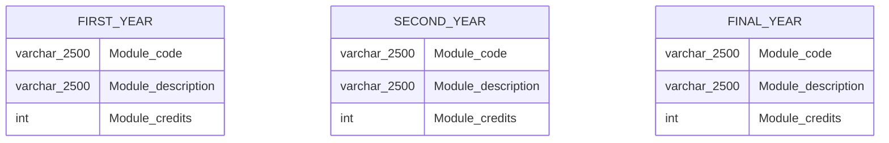
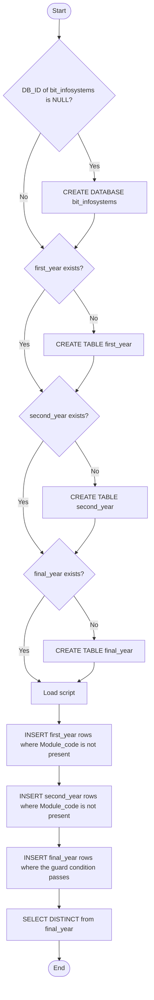

# BIT_InfoSystems Module Database

A T-SQL project for Microsoft SQL Server that builds and populates a small reference database of Bachelor of Information Technology (BIT) Information Systems modules, split by year of study.

## Overview

The project has two scripts. The setup script creates the `bit_infosystems` database and three tables. The load script inserts module codes, descriptions and credit values into those tables, and does so safely on repeat runs.

| Item | Detail |
|---|---|
| Platform | Microsoft SQL Server (T-SQL) |
| Database | `bit_infosystems` |
| Tables | `first_year`, `second_year`, `final_year` |
| Approx. rows | 27 first year, 25 second year, 17 final year |
| Re-runnable | Yes, both scripts are guarded against duplication |

## Data Model

All three tables share one structure. They are independent and have no foreign keys between them.



## Execution Flow



## Module Categories

Each year block groups rows with comments. These groupings are documentation only and are not stored as a column.

| Year | Fundamental | Core | Elective |
|---|---|---|---|
| First year | AIM 111, AIM 121, ALL 121, UPO 112 | INF and OBS modules | Marketing, statistics, economics, accounting, geography, interaction design |
| Second year | JCP 202 | FIL, INF modules | Accounting, tax, GIS, auditing, business, statistics, data science |
| Final year | None | INF 315, INF 324, INF 354, INF 370 | Tax, marketing, GIS, auditing, work-based learning, strategy, analytics, statistics |

## Usage

1. Open the setup script in SQL Server Management Studio or Azure Data Studio and run it against the target instance.
2. Run the load script.
3. Query any table to confirm the data, for example `SELECT * FROM bit_infosystems.dbo.first_year;`.

Each `GO` statement ends a batch, so the scripts must run in a client that supports `GO`, such as SSMS, `sqlcmd` or Azure Data Studio.

## How Duplicate Protection Works

Each load uses a `VALUES` table constructor aliased as `Source`, filtered with `WHERE NOT EXISTS` against the target table. A row is only inserted when no matching row is already present.

```sql
INSERT INTO BIT_InfoSystems.dbo.first_year (Module_code, Module_description, Module_credits)
SELECT source.module_code, source.module_description, source.module_credits
FROM (VALUES (...)) AS Source(Module_code, Module_description, Module_credits)
WHERE NOT EXISTS (
    SELECT 1 FROM bit_infosystems.dbo.first_year AS Target
    WHERE Target.Module_code = Source.Module_code
);
```

## Known Issues and Recommendations

1. **Wrong guard in the final year load.** The `NOT EXISTS` check compares `Module_credits` instead of `Module_code`. On a first run into an empty table this still inserts everything, but on a partial re-run it will skip any module whose credit value already exists. Change the condition to `Target.Module_code = Source.Module_code`.
2. **No primary key.** The tables have no constraint on `Module_code`, so the `NOT EXISTS` guard is the only defence against duplicates. Declare `Module_code` as `NOT NULL` with a `PRIMARY KEY`, and size it to `varchar(10)` rather than `varchar(2500)`.
3. **Three identical tables.** A single `modules` table with a `Year_level` column and a `Module_type` column (Fundamental, Core, Elective) would remove the repetition and let the category comments become queryable data. This answers the open question in the script about whether separating module types is clean code.
4. **Unneeded `DISTINCT`.** The closing `SELECT DISTINCT *` hides duplicates rather than preventing them. Once a primary key exists it can be a plain `SELECT *`.
5. **Hard-coded database name.** The scripts repeat `bit_infosystems` in mixed case. Adding `USE bit_infosystems;` after creation, and keeping the casing consistent, makes the scripts easier to maintain.
